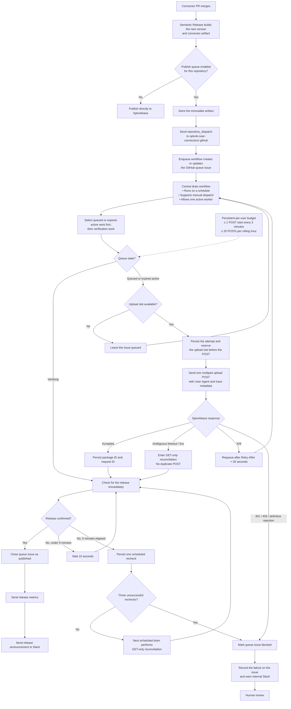

# Splunkbase connector publishing

Splunk SOAR connector releases use a centralized queue in
`splunk-soar-connectors/.github` to publish to Splunkbase. The queue provides durable
publication state, enforces the upload limit for the shared publishing identity, and
prevents an uncertain upload result from causing a duplicate submission.

## Publishing flow

When the queue is enabled for a connector repository, its release workflow stores the
immutable connector artifact and sends a `repository_dispatch` event to the central
repository. The `enqueue-splunkbase-publish.yml` workflow handles the event and creates
or updates the GitHub issue that represents the publication.

The `drain-splunkbase-publish-queue.yml` workflow is the central worker. It runs on a
schedule and can also be started manually with `workflow_dispatch`. A concurrency group
allows only one worker to drain the queue at a time.

## Queue model

Each publication is represented by:

- A GitHub issue containing the connector, version, source run, current state, and
  non-secret Splunkbase identifiers.
- An immutable connector artifact stored on the `splunkbase-publish-queue` prerelease.
- A deduplication key composed of the publishing-user alias, repository, and connector
  version.

The queue selects eligible queued or expired-active work before verification work.
Within each group it uses the oldest `enqueued_at` timestamp and then the issue number
as a stable tie-breaker. A drain run excludes every issue it has already selected, so
each eligible issue receives at most one processing attempt per run. Publication
credentials remain in GitHub Actions secrets and are not stored in issues or release
assets.

## Upload budget

Splunkbase permits 20 upload attempts per hour for each publishing user, and every
multipart upload attempt counts. The queue starts at most one upload every three
minutes and no more than 20 during the preceding hour.

Each worker run drains eligible work for at most 50 minutes or 20 started upload
attempts, whichever comes first. The workflow has a separate 60-minute hard timeout;
the internal deadline leaves margin for cleanup and notification. It records an upload
slot before making the POST, so a restart cannot reset the budget. Read-only Splunkbase
requests retain bounded retries, but multipart upload POSTs have no automatic retries.
HTTP 429 responses schedule another queue attempt after `Retry-After` plus 30 seconds.
Ambiguous transport results enter GET-only reconciliation and do not authorize another
POST.

Manual uploads must not use the same publishing identity while the queue is enabled
because they are not represented in the persisted budget.

## Publication verification

After Splunkbase accepts an upload, the queue persists the package and request IDs and
checks for the release immediately. It checks every 10 seconds for up to five minutes.
If publication is still not confirmed, the issue remains in verification and a later
worker continues with GET requests only. Each completed five-minute GET-only window
increments the persisted `verification_rechecks` counter. The first two unsuccessful
rechecks remain non-terminal; the third blocks the issue with a sanitized reason. The
escalation never authorizes another multipart upload.

Release metrics and the standard Slack release announcement are sent only after the
connector version is confirmed on Splunkbase.

For SDK apps, metrics compare the manifest in the immutable queued package with a
manifest generated from the previous semantic-release tag. Metrics and Slack
notifications are attempted independently so one failure does not suppress the other.

## Failure handling

| Condition | Queue behavior | Notification |
| --- | --- | --- |
| HTTP 429 | Requeue after `Retry-After` plus 30 seconds | None |
| Ambiguous timeout or server response | Continue GET-only reconciliation | None |
| Validation still pending or response unreadable, before three rechecks | Keep the issue in verification | None |
| Three unsuccessful five-minute verification rechecks | Block the issue for human review | Internal Slack warning |
| HTTP 401 or 403 | Block the issue for human review | Internal Slack warning |
| Definitive validation rejection | Block the issue for human review | Internal Slack warning |
| A newer connector version is already on Splunkbase | Delete the queued asset and close the blocked issue | None |
| Unexpected worker exception | Workflow fails | Internal Slack warning with the worker run |
| Cancelled or timed-out drain workflow | No queue mutation | Internal Slack warning with the worker run |

An active publication has a 15-minute lease. If the worker stops after recording an
attempt, the next eligible worker treats its result as ambiguous and performs GET-only
reconciliation.

The queue issue and internal blocked-publication warning include the connector, version,
specific failure reason, and worker-run link. Request and package IDs are included only
when the failure occurred after Splunkbase received an upload. The warning is independent
of `SEND_RELEASE_MESSAGE`, which controls standard release announcements.
The worker sends no transient verification-retry warning. A separate `workflow_run`
observer reports cancelled or timed-out drain runs because a cancelled worker may not
get a chance to run its own exception handler.

Blocked issues remain open until an operator resolves the cause and explicitly
authorizes another queue attempt, unless a later drain finds a newer connector version
on Splunkbase and evicts the stale item automatically. An operator must not retry the
multipart POST directly.

## Configuration

### Splunkbase v2 draft migration (PAPP-38509)

The central worker selects the new flow for repositories named in
`SPLUNKBASE_DRAFT_FLOW_REPOSITORIES`, a comma-separated Actions variable containing
full names such as `splunk-soar-connectors/example`. An empty value selects the
existing publishing flow. Enable the publishing queue for each selected repository
before adding it to this list; direct publishing still uses the existing flow.

The new flow logs in with a form-encoded POST, caches the JWT until its expiry,
and refreshes once after an explicit authentication rejection. It creates a draft
for a new listing, obtains a presigned S3 POST, uploads the package without
Splunkbase credentials, registers its filename and S3 key, and polls validation.
For existing listings, it reuses the numeric app ID.

After validation passes, the worker updates app metadata and release notes. New
drafts must have no missing `/required_fields/` before `/submit/`. Existing apps
publish the validated release with a release PATCH. Both paths require the exact
connector GUID and version to appear in unauthenticated public app search before
closing the queue item, deleting the artifact, or sending metrics and announcements.
Private validation success alone does not establish public availability.

#### Listing content

All documentation is read from the immutable package as Markdown. Only regular
files at the package root are read; the worker does not extract links or paths.

| Splunkbase field | Package source, in priority order |
| --- | --- |
| `description` | Connector manifest description |
| `documentation_source` | `details.md`; `## Details`; `manual_readme_content.md`; `README.md` |
| `installation_source` | `installation.md`; `## Installation` |
| `troubleshooting_source` | `troubleshooting.md`; `## Troubleshooting` |
| `contact_notes_source` | `contact.md`; `## Contact` |
| `contact_email` | Explicit manifest `contact_email`, when available |
| `support` | Explicit manifest support; otherwise `splunk` for a Splunk publisher |

Section headings are matched without regard to case. Sections come from
`manual_readme_content.md` when present, or `README.md` otherwise. Empty or absent
values are omitted, preserving curated listing content. Existing contact email and
support are preserved when already set on the listing. A tab body longer than
20,000 characters blocks publication with a request for a dedicated tab file.
Connector category strings are not converted to Splunkbase numeric category IDs.
Missing categories, compatibility, contact information, or other required listing
metadata are reported for the listing owner to complete before resuming.

#### Durable recovery

The queue stores `publication_flow=draft_v2`, the pending operation, app/package/
release IDs, the uploaded S3 object key, and whether publication was requested.
It checkpoints before each mutation and after accepting its result. S3 policy,
signature, session token, presigned URL, and JWT are never stored in the queue.

| Interrupted operation | Recovery |
| --- | --- |
| Draft creation, app ID not persisted | Hold for App Hosting to identify the created draft; do not repeat creation |
| S3 upload before package registration | Obtain a fresh presigned grant and upload an unregistered object |
| Package registration, package ID not persisted | Hold for App Hosting to identify the package; do not register again |
| Accepted package validation | Resume polling the saved package ID |
| Metadata or release PATCH | Repeat the same values from the immutable package |
| Draft submission | Read draft state; resume if submitted, or hold while its outcome remains unknown |
| Public visibility | Read public search without repeating uploads or submission |

HTTP 429 retains identifiers and schedules a retry after `Retry-After` plus
30 seconds. A rejected registration can reuse the uploaded object. A rejected
or expired S3 grant never triggers registration. HTTP 409, permanent permission
denial, validation failure, and incomplete metadata block the item for review.
The existing upload budget is reserved before each S3 attempt; the API's monthly
byte quota is also respected through HTTP 429. Confirm production quota accounting
with App Hosting before expanding the rollout.

To resume a held item, reconcile its IDs with App Hosting, update the queue issue's
`verification` checkpoint with the confirmed app or package ID, and clear the
resolved `pending_operation`. Preserve the immutable artifact and flow marker.
Return the item to verification only after confirming the failed operation's outcome.
Do not delete a draft or retry a registration to bypass an uncertain result.

Removing a repository from the canary list stops new work from selecting this flow.
Items with a saved `draft_v2` checkpoint continue through it. Existing legacy
verification items and interrupted legacy uploads finish through their original path.

#### Validation and rollout

The [Publishing tests workflow](workflows/publishing-tests.yml) runs repository
hooks and publisher/queue tests on the PR revision using a read-only token.
Its tests cover request formats, authentication refresh, S3 credential isolation,
validation versus publication, durable checkpoints, quota handling, and recovery.

Before enabling the first production repository, App Hosting and the connector team
must provide a staging publishing identity and test listings for a new app and an
existing release. The API client supports `SPLUNKBASE_ENVIRONMENT=STAGE` with matching
staging API and login hosts; use an isolated staging queue. Verify legacy and SDK
packages, all available listing tabs, restart recovery, and the final public version.
Attach that evidence and confirm quota behavior on PAPP-38509, then enable one
production repository and inspect its first publication before expanding the list.
Keep `draft: "true"` until App Hosting confirms that the flag can be retired.

Contract references: [migration guide](https://cisco-my.sharepoint.com/:w:/p/jramatow/IQBsArEQiaYvTY9ZkeDc_26RAZtnZyX7zQ_krNuKjGM73Dk?e=e8rxGb),
[v2 API documentation](https://stage.splunkbase.splunk.com/api-docs-v2/),
[OpenAPI schema](https://stage.splunkbase.splunk.com/schema/), and
[MP-510 metadata mapping](https://splunk.atlassian.net/browse/MP-510?focusedCommentId=20905715).

The queue path is selected when `SPLUNKBASE_PUBLISH_QUEUE_ENABLED=true` is available to
both the connector repository and `splunk-soar-connectors/.github`. If the variable is
unset or `false`, the connector uses direct publication. Direct publication and queued
publication must not run simultaneously under the same Splunkbase identity.

The central repository uses the following Actions secrets:

- `SPLUNKBASE_USER`
- `SPLUNKBASE_PASSWORD`
- `SLACK_INTERNAL_TOKEN`
- `SLACK_COMMUNITY_TOKEN`

Slack behavior uses the following Actions variables:

- `SLACK_INTERNAL_CHANNEL_ID`
- `SLACK_COMMUNITY_CHANNEL_ID`
- `SEND_RELEASE_MESSAGE`

The connector release workflow uses `SEMANTIC_RELEASE_APP_ID` and
`SEMANTIC_RELEASE_PK` to obtain a token for storing the queue artifact and sending the
enqueue event. The GitHub App requires `contents:write` on
`splunk-soar-connectors/.github`. The central workflows use their repository-scoped
`GITHUB_TOKEN` with `issues:write` to manage queue issues.

CrowdSec remains excluded until its Splunkbase publishing-user invitation is accepted.
Microsoft OneDrive v2 remains excluded from queued publication.

## Tracing

Splunkbase uploads use the `Splunk-SOAR-Connector-Publisher/1.0` User-Agent and include
the connector repository, version, source workflow run, and source attempt. The queue
issue records package and request IDs when Splunkbase provides them.

## Disabling the queue

Set `SPLUNKBASE_PUBLISH_QUEUE_ENABLED=false` and wait for any active worker to finish
before resuming direct publication with the same Splunkbase identity.

_This documentation was written by Codex._
